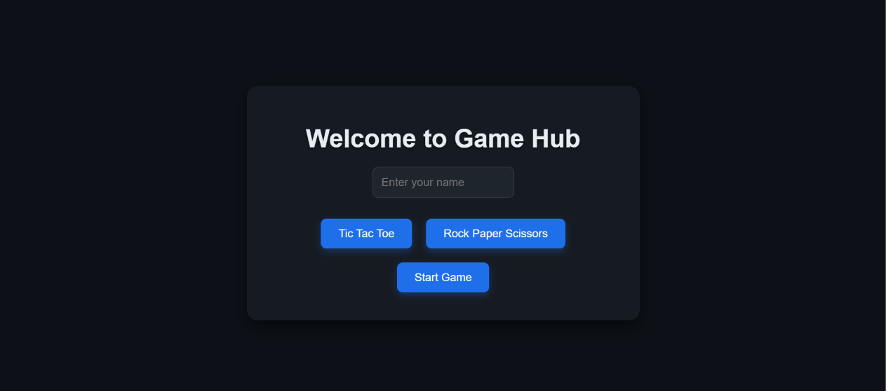
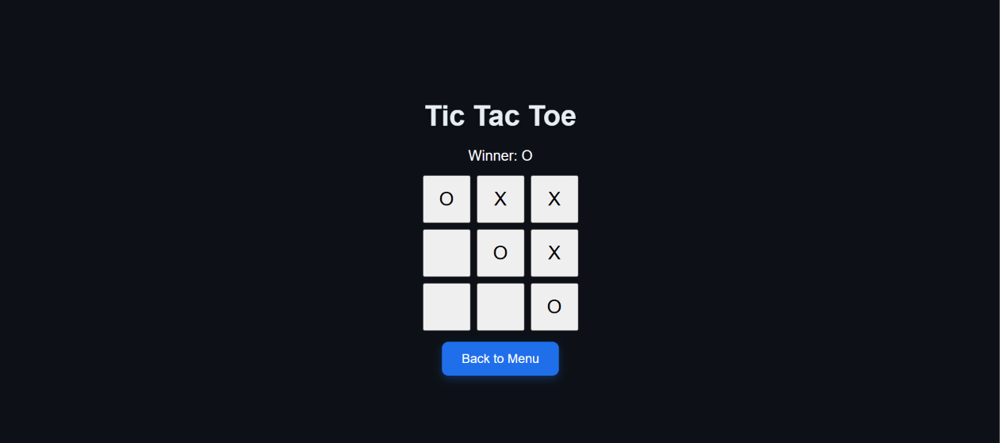
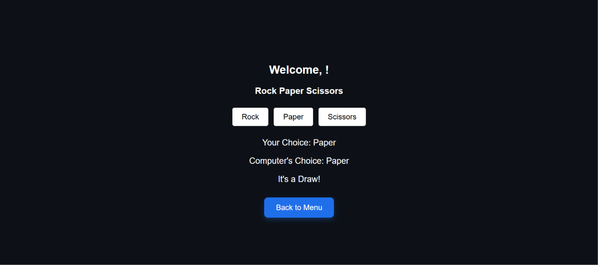

# Game Hub

### Two classic games, one React.js interface

[**Play the live demo**](https://benevolent-unicorn-8dc7b3.netlify.app/)

## Overview

Game Hub is a browser-based project built with React.js that brings Tic Tac Toe and Rock Paper Scissors together in one interface. A central menu lets players enter a name, choose a game, and start playing.

## Games & Features

### Tic Tac Toe
- A classic 3 × 3 board with X and O moves.
- An on-screen winner indicator.
- A button to return to the main menu.

### Rock Paper Scissors
- Play a round against the computer.
- See both the player's choice and the computer's choice.
- View the round outcome, including a draw.
- Return to the menu to choose another game.

### Interface
- A shared menu for selecting between the two games.
- A player-name input and welcome display.
- Dark styling with blue navigation buttons.

## My Role

Developed the Game Hub web application using React.js.

## Technologies

| Technology | Purpose |
| --- | --- |
| React.js | Interactive user interface |
| Netlify | Hosting the live demo |

## Try It

1. Open the [live demo](https://benevolent-unicorn-8dc7b3.netlify.app/).
2. Enter a name and choose a game.
3. Select **Start Game**.
4. Use **Back to Menu** to switch games.
